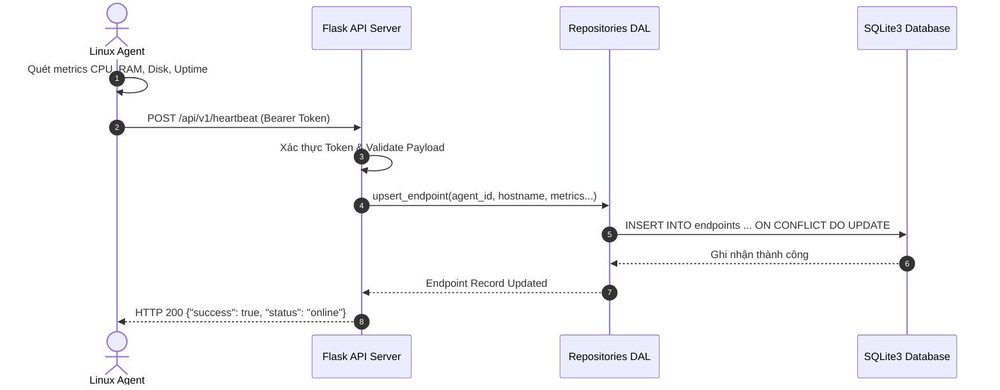
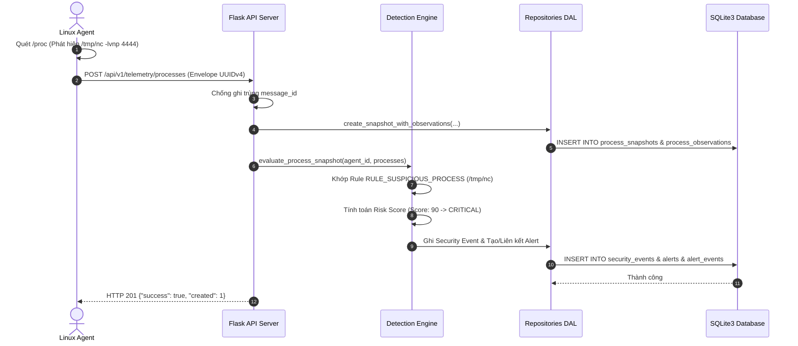
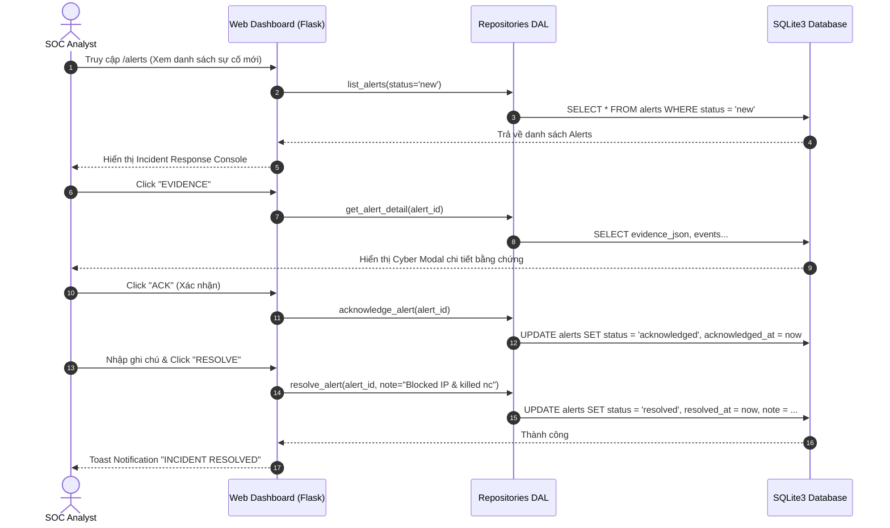

# Mini EDR Linux --- Kiến trúc Hệ thống & Thiết kế Cơ sở Dữ liệu

**Phiên bản:** 2.0 (Toàn diện từ Phase 1 đến Phase 8)  
**Ngày cập nhật:** 05/11/2026  
**Dự án:** Mini Endpoint Detection and Response for Linux  
**Repository:** `r00tK1ngX/mini-edr-linux`

---

## 1. Tổng quan Kiến trúc Toàn Hệ thống

Mini EDR Linux là giải pháp giám sát an ninh đầu cuối (Endpoint Detection and Response) theo kiến trúc Client-Server mô-đun hóa cao, phát triển chuyên biệt cho môi trường Linux (Ubuntu, Debian, Kali Linux, CentOS/RHEL). Hệ thống kết hợp giữa việc thu thập dữ liệu sâu trên endpoint, xử lý xác thực tập trung, động cơ phân tích tương quan phát hiện mối đe dọa (Detection Engine), và bảng điều khiển SOC Command Center mang phong cách Cyberpunk Hacker hiện đại.

```text
┌────────────────────────────────────────────────────────────────────────────────────────┐
│                                 LINUX AGENT (Client)                                   │
│                                                                                        │
│   ┌───────────────────────┐   ┌───────────────────────┐   ┌────────────────────────┐   │
│   │   System Collector    │   │   Process Collector   │   │  File Integrity (FIM)  │   │
│   │ (CPU, RAM, Disk, UP)  │   │(PID, User, Exe, RSS)  │   │ (SHA-256, State, Mode) │   │
│   └───────────┬───────────┘   └───────────┬───────────┘   └───────────┬────────────┘   │
│               │                           │                           │                │
│               └───────────────────────────┼───────────────────────────┘                │
│                                           ▼                                            │
│                        ┌─────────────────────────────────────┐                         │
│                        │       Agent Orchestrator Loop       │                         │
│                        │    (Periodic Scanning & Scheduling) │                         │
│                        └──────────────────┬──────────────────┘                         │
│                                           ▼                                            │
│                        ┌─────────────────────────────────────┐                         │
│                        │       Agent HTTP Client             │                         │
│                        │ (Envelope UUIDv4, Bearer Auth, Retry)│                        │
│                        └──────────────────┬──────────────────┘                         │
└───────────────────────────────────────────┼────────────────────────────────────────────┘
                                            │ HTTP / JSON (Envelope 1.0)
                                            ▼
┌────────────────────────────────────────────────────────────────────────────────────────┐
│                              FLASK API SERVER & BACKEND                                │
│                                                                                        │
│   ┌────────────────────────────────────────────────────────────────────────────────┐   │
│   │                        API Routing & Security Layer                            │   │
│   │  - Bearer Token Auth Guard       - Schema Validation (Cerberus/JSON Schema)    │   │
│   │  - Max Content Length (64 KB)    - Replay Attack Mitigation (UUIDv4 Dedup)     │   │
│   │  - Endpoints: /heartbeat, /telemetry/*, /file-baselines, /events, /alerts      │   │
│   └───────────────────────────────────────┬────────────────────────────────────────┘   │
│                                           │                                            │
│                                           ▼                                            │
│   ┌────────────────────────────────────────────────────────────────────────────────┐   │
│   │                           DETECTION ENGINE (Phát hiện)                         │   │
│   │  - Rule Registry (Process & FIM Rules) - Correlation Engine (Multi-event)      │   │
│   │  - Risk Scoring Algorithm (0 - 100)    - Alert Dispatcher & De-duplication     │   │
│   └───────────────────────────────────────┬────────────────────────────────────────┘   │
│                                           │                                            │
│                                           ▼                                            │
│   ┌────────────────────────────────────────────────────────────────────────────────┐   │
│   │                     Data Access Layer (DAL Repositories)                       │   │
│   │  - EndpointRepository    - SystemMetricsRepository   - ProcessRepository       │   │
│   │  - BaselineRepository    - SecurityEventRepository   - AlertRepository         │   │
│   │  * 100% Parameterized SQL Queries & Context-managed Transactions               │   │
│   └───────────────────────────────────────┬────────────────────────────────────────┘   │
│                                           │                                            │
│                                           ▼                                            │
│   ┌────────────────────────────────────────────────────────────────────────────────┐   │
│   │                          SQLite3 Database Engine                               │   │
│   │  - WAL Mode (Write-Ahead Logging)       - Foreign Keys Enforced (PRAGMA fk=ON) │   │
│   │  - Busy Timeout 5000ms                  - Automated Migration Runner           │   │
│   └────────────────────────────────────────────────────────────────────────────────┘   │
└───────────────────────────────────────────┬────────────────────────────────────────────┘
                                            │ Internal Data Query
                                            ▼
┌────────────────────────────────────────────────────────────────────────────────────────┐
│                    CYBERPUNK WEB DASHBOARD (SOC Command Center)                        │
│                                                                                        │
│   ┌────────────────────────────────────────────────────────────────────────────────┐   │
│   │ Flask Web Blueprint (server/web.py) + Jinja2 Security Escaped Templates        │   │
│   │   - /dashboard : Network KPI Tiles, Resource Meters, Severity Matrix, Live feed│   │
│   │   - /endpoints : Multi-agent Fleet Inventory, Live Search, Inspection Modals   │   │
│   │   - /alerts    : Triage Console (Acknowledge, Resolve with Note, Dismiss AJAX) │   │
│   │   - /events    : Security Audit Logs & FIM Telemetry Explorer                  │   │
│   │   - static/    : Pure CSS3 Cyberpunk Grid & Vanilla ES6+ (Offline/Air-gapped)  │   │
│   └────────────────────────────────────────────────────────────────────────────────┘   │
└────────────────────────────────────────────────────────────────────────────────────────┘
```

---

## 2. Các Thành phần Hệ thống Chi tiết

### 2.1. Phân hệ Linux Agent (`agent/`)

Linux Agent hoạt động độc lập, gọn nhẹ, chạy ngầm trên máy khách không đòi hỏi quyền root tuyệt đối cho các tác vụ đo lường thông thường:

1. **System Collector (`agent/system_collector.py`):**
   - Thu thập thông số tĩnh: `hostname`, non-loopback `ip_address`, phiên bản hệ điều hành `os`.
   - Thu thập chuỗi thời gian: `cpu_percent` (qua `psutil.cpu_percent`), `memory_percent` (qua `psutil.virtual_memory`), `disk_percent` (qua `psutil.disk_usage`), và `uptime_seconds` (tính từ `psutil.boot_time`).
   - Xử lý phân quyền an toàn: Trả về giá trị fallback hợp lệ khi gặp lỗi cấp quyền hoặc cấm truy cập phần cứng.

2. **Process Collector (`agent/process_collector.py`):**
   - Quét toàn diện bảng tiến trình của hệ điều hành Linux qua `/proc` bằng thư viện `psutil`.
   - Trích xuất: `pid`, `ppid`, `name`, `username`, `exe_path`, `cmdline`, `cpu_percent`, `memory_percent`, `rss_bytes`, `process_started_at`.
   - Bắt các ngoại lệ đặc trưng của Linux kernel: `NoSuchProcess` (tiến trình tắt giữa chừng), `AccessDenied` (tiến trình của root/kernel thread), và `ZombieProcess`.

3. **File Integrity Monitoring (`agent/file_integrity.py`):**
   - Giám sát các tệp tin cấu hình và nhị phân then chốt (như `/etc/passwd`, `/etc/shadow`, `/usr/bin/sudo`, các tệp trong `/bin`, `/sbin`).
   - Tính toán mã băm mật mã học **SHA-256** (chuẩn 64 ký tự hex chữ thường).
   - Phát hiện 3 loại biến động tệp tin:
     - `created`: Tệp mới xuất hiện trong thư mục được giám sát.
     - `modified`: Tệp bị thay đổi nội dung (mã băm khác biệt) hoặc thay đổi quyền hạn `file_mode`.
     - `deleted`: Tệp biến mất khỏi hệ thống (chuyển trạng thái baseline thành `missing`).

4. **Agent Orchestrator (`agent/orchestrator.py`):**
   - Điều phối vòng lặp vận hành (Heartbeat loop, Metrics loop, Process snapshot loop, FIM baseline/scan loop).
   - Quản lý hàng đợi và thời điểm thu thập dữ liệu có chu kỳ, xử lý ngắt an toàn `SIGINT`/`SIGTERM`.

5. **Agent HTTP Client (`agent/client.py`):**
   - Đóng gói dữ liệu theo chuẩn Common Telemetry Envelope 1.0 (tạo `message_id` UUIDv4 duy nhất, timestamp ISO 8601 UTC).
   - Đính kèm Bearer Token xác thực trong header `Authorization`.
   - Cơ chế Retry và bắt lỗi kết nối khi Server tạm thời mất liên lạc.

---

### 2.2. Phân hệ API Server & Data Ingestion (`server/routes.py`, `server/app.py`)

- **Kiến trúc Application Factory:** Khởi tạo ứng dụng Flask qua hàm `create_app(test_config=None)`, hỗ trợ cấu hình tách biệt giữa môi trường kiểm thử và vận hành thật.
- **Xác thực Bearer Token:** Kiểm tra header `Authorization: Bearer <TOKEN>` thông qua middleware decorator `require_api_token`.
- **Kiểm soát kích thước (Rate & Payload Limiting):** Cấu hình `MAX_CONTENT_LENGTH = 64 * 1024` (64 KB) ngăn chặn tấn công từ chối dịch vụ (DoS) bằng payload khổng lồ.
- **Xác thực dữ liệu chặt chẽ (Schema Validation):**
  - Kiểm tra tính hợp lệ của `message_id` (chuẩn UUIDv4).
  - Kiểm tra `schema_version` (bắt buộc `"1.0"`).
  - Kiểm tra phạm vi đo lường metrics (CPU/RAM/Disk nằm trong đoạn $[0, 100]$).
  - Chống trùng lặp (Idempotency): Trả về HTTP 200 cho bản tin gửi lặp có cùng nội dung hoặc HTTP 409 khi xung đột dữ liệu.

---

### 2.3. Phân hệ Detection Engine & Phân tích Tương quan (`server/detection/`)

Detection Engine chạy theo thời gian thực mỗi khi Server tiếp nhận dữ liệu telemetry tiến trình hoặc sự kiện toàn vẹn tệp:

```text
       Incoming Telemetry (Process Snapshot / FIM Event)
                              │
                              ▼
                   ┌───────────────────────┐
                   │ Detection Engine Core │
                   │(server/detection/...) │
                   └──────────┬────────────┘
                              │
           ┌──────────────────┴──────────────────┐
           ▼                                     ▼
┌─────────────────────────┐           ┌─────────────────────────┐
│ Process Detection Rules │           │   FIM Detection Rules   │
│  - Suspicious Process   │           │  - Sensitive File Change│
│  - Shell Spawning       │           │  - Critical Hash Mod    │
│  - High CPU Anomalies   │           └──────────┬──────────────┘
└──────────┬──────────────┘                      │
           │                                     │
           └──────────────────┬──────────────────┘
                              │ Triggered Events
                              ▼
                   ┌───────────────────────┐
                   │  Correlation Engine   │
                   │(Multi-event, Weights) │
                   └──────────┬────────────┘
                              │
                              ▼
                   ┌───────────────────────┐
                   │ Risk Score Evaluation │
                   │  Score: 0 to 100 (Max)│
                   └──────────┬────────────┘
                              │
                              ▼
                   ┌───────────────────────┐
                   │ Alert Dispatcher      │
                   │(Deduplication by key) │
                   └──────────┬────────────┘
                              │
                              ▼
            Saved to `alerts` & `alert_events`
```

1. **Rule Registry (`server/detection/rules.py`):**
   - Đăng ký danh mục các quy tắc phát hiện rõ ràng (explainable rules):
     - `RULE_SUSPICIOUS_PROCESS`: Phát hiện các công cụ pentest/hack điển hình (`nc`, `netcat`, `nmap`, `mimikatz`, `chisel`, `socat`) hoặc chạy từ các đường dẫn bất thường (`/tmp`, `/dev/shm`).
     - `RULE_SHELL_SPAWN`: Phát hiện tiến trình shell tương tác (`bash`, `sh`, `zsh`) được sinh ra từ các tiến trình web server (`apache2`, `nginx`) hoặc môi trường runtime (`python`, `php`).
     - `RULE_HIGH_CPU_PROCESS`: Phát hiện dấu hiệu đào tiền ảo (cryptomining) hoặc tấn công từ chối dịch vụ khi một tiến trình chiếm dụng $> 85\%$ CPU trong chu kỳ quét.
     - `RULE_FIM_SENSITIVE_FILE`: Phát hiện hành vi can thiệp trái phép vào các tệp bảo mật hệ thống (`/etc/passwd`, `/etc/shadow`, `/etc/sudoers`, `/root/.ssh/authorized_keys`).

2. **Cơ chế Phân tích Tương quan & Tính điểm Rủi ro (Correlation & Risk Scoring):**
   - Kết hợp nhiều dấu hiệu trên cùng một endpoint trong cửa sổ thời gian xác định.
   - Tránh dương tính giả (False Positive) bằng trọng số tương quan: Ví dụ một tiến trình có CPU cao đơn thuần chỉ tính rủi ro thấp/trung bình, nhưng nếu tiến trình đó nằm trong `/tmp` và FIM đồng thời báo `/etc/shadow` bị sửa đổi, hệ số rủi ro lập tức tăng vọt lên mức `CRITICAL` ($> 80$).

3. **Khử trùng Cảnh báo (Alert De-duplication):**
   - Sử dụng khóa tổng hợp `alert_key` dạng `<agent_id>:<rule_id>:<target_fingerprint>`.
   - Nếu sự cố tương tự tiếp tục xảy ra khi cảnh báo chưa đóng, hệ thống chỉ cập nhật `last_seen_at` và gắn thêm sự kiện vào bảng liên kết `alert_events` mà không tạo rác cảnh báo.

---

### 2.4. Phân hệ Web Dashboard & SOC Console (`server/web.py`)

Bảng điều khiển Web phục vụ chuyên viên SOC theo phong cách Cyberpunk Hacker:
- **Độc lập hoàn toàn (Air-gapped Ready):** 100% tài nguyên CSS và JS được lưu trữ cục bộ tại `static/`, không phụ thuộc vào Internet hay CDN bên ngoài.
- **Chống tấn công XSS:** Triệt để khử ký tự nguy hiểm với cơ chế `escapeHtml()` trong JavaScript và ngữ cảnh thoát chuỗi an toàn của Jinja2.
- **Quản lý Vòng đời Sự cố:** Hỗ trợ thực thi AJAX tức thời các thao tác:
  - `Acknowledge`: Tiếp nhận xử lý sự cố.
  - `Resolve`: Đóng sự cố kèm ghi chú nguyên nhân (`resolution_note`).
  - `Dismiss`: Bỏ qua cảnh báo dương tính giả.
  - **State Guard:** Chặn lùi trạng thái từ `resolved` về `acknowledged`.

---

## 3. Sơ đồ Thực thể Liên kết (Entity-Relationship Diagram - ERD)

Toàn bộ mô hình dữ liệu được thiết kế theo chuẩn dạng chuẩn 3NF và thực thi toàn vẹn tham chiếu thông qua SQLite Foreign Keys:


---

## 4. Luồng Thực thi & Tương tác Hệ thống (Sequence Diagrams)

### 4.1. Luồng Thu thập Telemetry & Heartbeat



### 4.2. Luồng Phát hiện Tiến trình Bất thường & Kích hoạt Alert



### 4.3. Luồng SOC Analyst Xử lý Sự cố trên Web Dashboard



---

## 5. Kiến trúc An toàn & Bảo mật (Security Hardening)

1. **Authentication & Authorization:**
   - Bảo vệ toàn bộ các API endpoint `/api/v1/*` bằng Bearer Token mật mã học.
   - Cơ chế Redaction trong log: Tự động che giấu giá trị token khi ghi nhận request log, ngăn chặn rò rỉ credential qua log files.
2. **Phòng chống Tấn công Tiêm mã SQL (SQL Injection):**
   - 100% các câu truy vấn tương tác cơ sở dữ liệu đều đi qua Data Access Layer (DAL) sử dụng câu lệnh có tham số hóa (Parameterized Queries). Tuyệt đối cấm nối chuỗi SQL. Đã kiểm chứng qua bộ probe SQL Injection nâng cao.
3. **Phòng chống Tấn công Cross-Site Scripting (XSS):**
   - Phía Frontend: Hàm `escapeHtml()` trong JavaScript xử lý toàn bộ dữ liệu động trước khi chèn vào DOM.
   - Phía Backend: Bộ sinh giao diện Jinja2 bật chế độ tự động escape (Autoescape) mặc định cho toàn bộ template HTML.
4. **Phòng chống Tấn công Gửi lặp (Replay Attack & Idempotency):**
   - Mỗi bản tin telemetry mang một định danh duy nhất `message_id` chuẩn UUIDv4.
   - Server kiểm tra ràng buộc duy nhất trong cơ sở dữ liệu; nếu bản tin đã tồn tại với cùng nội dung thì trả về HTTP 200, nếu xung đột dữ liệu sẽ trả về HTTP 409.
5. **Giới hạn Tài nguyên & Phòng chống DoS:**
   - Cấu hình `MAX_CONTENT_LENGTH = 64KB` chặn đứng các payload dung lượng lớn gây quá tải RAM.
   - SQLite cấu hình ở chế độ WAL (Write-Ahead Logging) cho phép đọc và ghi song song mà không bị nghẽn (locking). Timeout chờ khóa cơ sở dữ liệu là 5.000 ms.
6. **Vận hành An toàn trên Endpoint:**
   - Linux Agent không yêu cầu đặc quyền can thiệp nhân kernel.
   - Không tự động thực thi lệnh tiêu diệt tiến trình (`kill -9`) để đảm bảo tuyệt đối an toàn cho máy trạm trong môi trường học thuật và demo.

---

## 6. Giới hạn Thiết kế và Hướng phát triển

- **Phạm vi hiện tại:** Mini EDR được thiết kế chuyên biệt cho hệ điều hành Linux với cơ sở dữ liệu nhúng SQLite, phù hợp quy mô lab từ 1 đến 50 endpoints.
- **Hướng mở rộng tương lai:**
  - Hỗ trợ eBPF (Extended Berkeley Packet Filter) để giám sát syscalls ở tầng kernel với hiệu năng cao hơn so với quét `/proc`.
  - Tích hợp giao thức gRPC hoặc WebSockets hai chiều cho phép đẩy lệnh phản ứng tức thời từ Server xuống Agent (Isolate host, terminate process).
  - Hỗ trợ phân tán backend với PostgreSQL hoặc Elasticsearch khi số lượng endpoints mở rộng lên hàng nghìn thiết bị.
