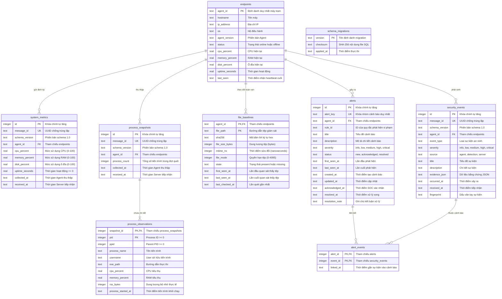

# Mini EDR Linux --- Kiến trúc Hệ thống & Thiết kế Cơ sở Dữ liệu

**Phiên bản:** 1.0  
**Ngày cập nhật:** 05/11/2026  
**Dự án:** Mini Endpoint Detection and Response for Linux  
**Repository:** `r00tK1ngX/mini-edr-linux`

---

## 1. Tổng quan Kiến trúc Hệ thống

Mini EDR Linux là giải pháp giám sát an ninh đầu cuối dạng mô-đun, gọn nhẹ, được thiết kế theo mô hình Client-Server phục vụ các hệ điều hành Linux (Ubuntu, Debian, Kali Linux, v.v.):

```text
┌────────────────────────────────────────────────────────────────────────┐
│                          LINUX AGENT (Client)                          │
│                                                                        │
│   ┌──────────────────────┐  ┌──────────────────────┐  ┌─────────────┐  │
│   │   System Collector   │  │  Process Collector   │  │ File Mon/FIM│  │
│   │ (CPU, RAM, Disk, UP) │  │(PID, Name, User, RSS)│  │ (SHA256,Mod)│  │
│   └──────────┬───────────┘  └──────────┬───────────┘  └──────┬──────┘  │
│              │                         │                     │         │
│              └─────────────────────────┼─────────────────────┘         │
│                                        ▼                               │
│                         ┌─────────────────────────────┐                │
│                         │        Agent Client         │                │
│                         │ (Envelope, Bearer Token)    │                │
│                         └──────────────┬──────────────┘                │
└────────────────────────────────────────┼───────────────────────────────┘
                                         │ HTTPS / HTTP POST
                                         ▼
┌────────────────────────────────────────────────────────────────────────┐
│                        FLASK API SERVER (Backend)                      │
│                                                                        │
│   ┌────────────────────────────────────────────────────────────────┐   │
│   │                  API Routes & Authentication                   │   │
│   │          (/heartbeat, /telemetry/*, /file-baselines, /events)  │   │
│   └────────────────────────────────┬───────────────────────────────┘   │
│                                    │                                   │
│                                    ▼                                   │
│   ┌────────────────────────────────────────────────────────────────┐   │
│   │             Data Access Layer (DAL) Repositories               │   │
│   │ (Endpoint, Metrics, Process, Baseline, Event, Alert Repos)    │   │
│   └────────────────────────────────┬───────────────────────────────┘   │
│                                    │                                   │
│                                    ▼                                   │
│   ┌────────────────────────────────────────────────────────────────┐   │
│   │                   SQLite3 Database Engine                      │   │
│   │         (WAL mode, Foreign Keys ON, Busy Timeout 5000ms)       │   │
│   └────────────────────────────────────────────────────────────────┘   │
└────────────────────────────────────────────────────────────────────────┘
```

---

## 2. Sơ đồ Thực thể Liên kết (Entity-Relationship Diagram - ERD)

Toàn bộ mô hình dữ liệu của Mini EDR được chuẩn hóa và quản lý quan hệ toàn vẹn thông qua các bảng sau:



---

## 3. Đặc tả Chi tiết các Bảng Dữ liệu

### 3.1. `endpoints` (Quản lý thiết bị đầu cuối)
* **Vai trò:** Lưu trữ danh mục các máy Linux kết nối về server; cập nhật trạng thái hoạt động thông qua cơ chế heartbeat định kỳ.
* **Khóa chính:** `agent_id` (TEXT).
* **Quy tắc tính toán trạng thái:** Trường `status` nhận giá trị `'online'` khi có heartbeat gửi về, và tự động chuyển `'offline'` khi khoảng cách từ `last_seen` đến thời điểm truy vấn vượt quá ngưỡng `OFFLINE_AFTER_SECONDS` (mặc định 15s).
* **Index:** `idx_endpoints_last_seen` trên cột `last_seen`.

### 3.2. `system_metrics` (Lịch sử sử dụng tài nguyên)
* **Vai trò:** Lưu trữ chuỗi thời gian các chỉ số CPU, RAM, Disk và Uptime của từng máy trạm.
* **Khóa chính:** `id` (INTEGER AUTOINCREMENT).
* **Khóa ngoại:** `agent_id` tham chiếu `endpoints(agent_id)` với quy tắc `ON DELETE RESTRICT`.
* **Ràng buộc:** `CHECK (cpu_percent >= 0 AND cpu_percent <= 100)`, tương tự cho `memory_percent` và `disk_percent`.
* **Index:** `idx_system_metrics_agent_collected` trên `(agent_id, collected_at DESC)`.

### 3.3. `process_snapshots` & `process_observations` (Giám sát tiến trình)
* **Vai trò:** Theo dõi vòng đời tiến trình hệ thống theo từng đợt thu thập snapshot.
* **Quan hệ 1 - N:** Một `process_snapshots` có thể chứa hàng chục đến hàng trăm `process_observations`.
* **Khóa ghép:** Bảng `process_observations` sử dụng khóa chính ghép `(snapshot_id, pid)` để phân biệt các tiến trình trong cùng một chu kỳ quét.
* **Xóa theo tầng (Cascade):** Khi một snapshot bị xóa, toàn bộ observations liên kết tự động bị xóa theo (`ON DELETE CASCADE`).

### 3.4. `file_baselines` (Giám sát toàn vẹn tệp - FIM)
* **Vai trò:** Lưu giữ trạng thái chuẩn (baseline) của các tệp tin quan trọng (như `/etc/passwd`, `/etc/shadow`, binaries trong `/bin`, v.v.).
* **Khóa ghép:** `(agent_id, file_path)`.
* **Ràng buộc hash:** `CHECK (length(sha256) = 64 AND sha256 NOT GLOB '*[^0-9a-f]*')` - bảo đảm mã băm luôn là chuỗi 64 ký tự hex chữ thường.
* **Bảo tồn dấu vết:** Khi tệp bị xóa khỏi máy trạm, bản ghi không bị xóa cứng mà chuyển sang `state = 'missing'` để bảo toàn lịch sử hash phục vụ điều tra forensics.

### 3.5. `security_events` (Kho sự kiện an ninh)
* **Vai trò:** Lưu trữ các biến cố bất thường do Agent phát hiện hoặc do Detection Engine sinh ra.
* **Ràng buộc mức độ:** `severity IN ('info', 'low', 'medium', 'high', 'critical')`.
* **Index:** Đầy đủ index trên `(agent_id, occurred_at DESC)`, `(severity, occurred_at DESC)`, `event_type` và `fingerprint`.

### 3.6. `alerts` & `alert_events` (Quản lý cảnh báo & Sự cố)
* **Vai trò:** Quản lý vòng đời xử lý sự cố an ninh của quản trị viên/SOC.
* **Tương quan (Correlation):** Sử dụng `alert_key` duy nhất để nhóm các sự kiện liên quan vào một cảnh báo duy nhất thay vì tạo cảnh báo trùng lặp.
* **Vòng đời trạng thái:** `new` ➔ `acknowledged` ➔ `resolved`. Có ràng buộc logic CHECK bắt buộc phải có `acknowledged_at` hoặc `resolved_at` tương ứng với trạng thái.
* **Bảng cầu nối:** `alert_events` quản lý quan hệ nhiều - nhiều giữa `alerts` và `security_events`.

---

## 4. Kiến trúc Data Access Layer (DAL)

Tầng truy cập dữ liệu được đặt tại `server/repositories/` nhằm cô lập toàn bộ các truy vấn SQL, đảm bảo tính đóng gói và an toàn dữ liệu:

* **`BaseRepository`:** Cung cấp context manager `_connection()`. Nếu gọi đơn lẻ, context tự động mở kết nối, thực hiện transaction và đóng kết nối. Nếu truyền kết nối có sẵn, context sẽ tái sử dụng kết nối đó để thực hiện các thao tác nguyên khối (atomic).
* **An toàn SQL:** 100% câu lệnh sử dụng parameterized queries với tham số vị trí `?` hoặc tham số định danh `:key`. Tuyệt đối không nối chuỗi (String Concatenation).
* **Nhất quán dữ liệu:** Mọi truy vấn trả về cấu trúc chuẩn `dict` từ SQLite `Row`, giúp các route và business logic không phụ thuộc vào driver cơ sở dữ liệu.

---

## 5. Hệ thống Migration Framework

Hệ thống sử dụng cơ chế migration phiên bản độc lập đặt tại `server/migrations/runner.py`:

1. **Thứ tự áp dụng:** Quét các tệp `.sql` theo thứ tự tên tệp (ví dụ `001_phase2_data_model.sql`).
2. **Kiểm tra Checksum:** Mỗi file migration được tính mã băm SHA-256 và lưu vào bảng `schema_migrations`. Nếu file migration đã chạy trong quá khứ bị chỉnh sửa nội dung, runner sẽ lập tức báo lỗi và dừng server.
3. **Rollback an toàn:** Mỗi migration file được chạy trong một SQLite transaction riêng biệt. Nếu có lỗi cú pháp hoặc vi phạm ràng buộc, toàn bộ thay đổi sẽ được rollback ngay lập tức.
