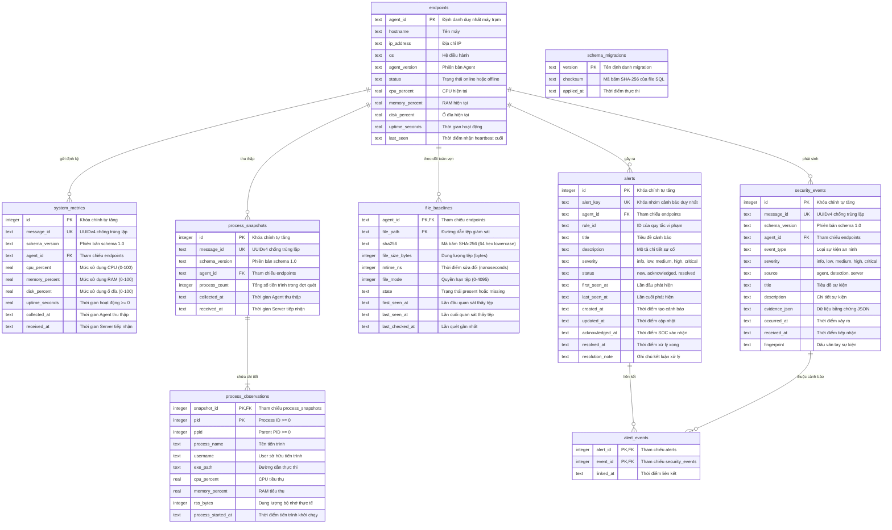
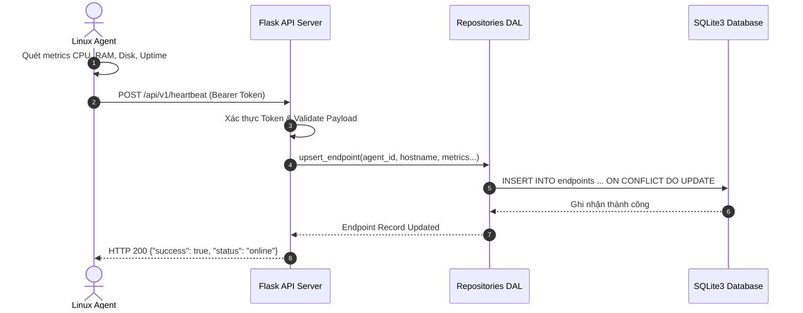
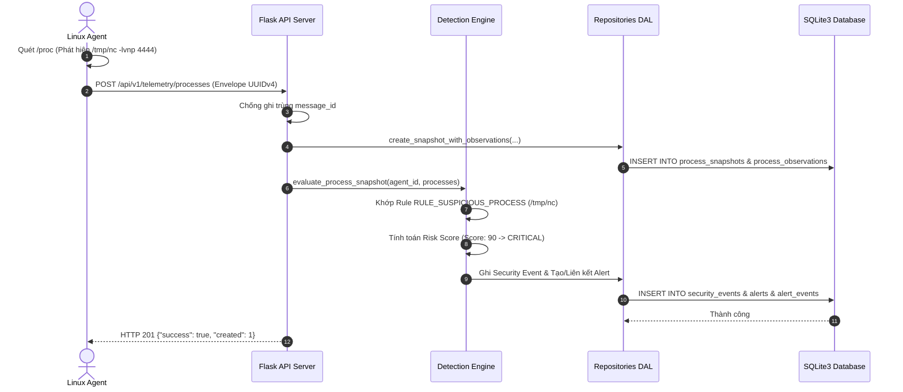
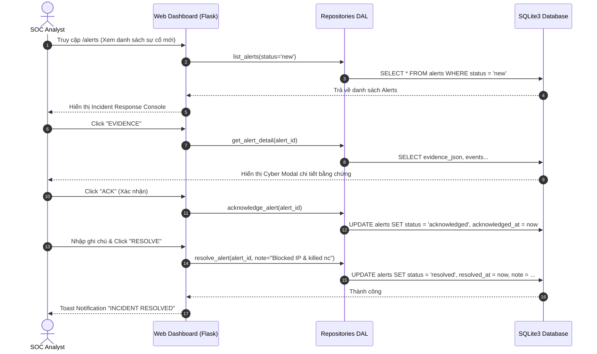

# Mini EDR Linux --- Kiến trúc Hệ thống & Thiết kế Cơ sở Dữ liệu

**Phiên bản:** 2.0 (Toàn diện từ Phase 1 đến Phase 8)  
**Ngày cập nhật:** 05/11/2026  
**Dự án:** Mini Endpoint Detection and Response for Linux  
**Repository:** `r00tK1ngX/mini-edr-linux`

---

## 1. Tổng quan Kiến trúc Toàn Hệ thống

Mini EDR Linux là giải pháp giám sát an ninh đầu cuối (Endpoint Detection and Response) theo kiến trúc Client-Server mô-đun hóa cao, phát triển chuyên biệt cho môi trường Linux (Ubuntu, Debian, Kali Linux, CentOS/RHEL). Hệ thống kết hợp giữa việc thu thập dữ liệu sâu trên endpoint, xử lý xác thực tập trung, động cơ phân tích tương quan phát hiện mối đe dọa (Detection Engine), và bảng điều khiển SOC Command Center mang phong cách Cyberpunk Hacker hiện đại.

```text
┌────────────────────────────────────────────────────────────────────────────────────────┐
│                                 LINUX AGENT (Client)                                   │
│                                                                                        │
│   ┌───────────────────────┐   ┌───────────────────────┐   ┌────────────────────────┐   │
│   │   System Collector    │   │   Process Collector   │   │  File Integrity (FIM)  │   │
│   │ (CPU, RAM, Disk, UP)  │   │(PID, User, Exe, RSS)  │   │ (SHA-256, State, Mode) │   │
│   └───────────┬───────────┘   └───────────┬───────────┘   └───────────┬────────────┘   │
│               │                           │                           │                │
│               └───────────────────────────┼───────────────────────────┘                │
│                                           ▼                                            │
│                        ┌─────────────────────────────────────┐                         │
│                        │       Agent Orchestrator Loop       │                         │
│                        │    (Periodic Scanning & Scheduling) │                         │
│                        └──────────────────┬──────────────────┘                         │
│                                           ▼                                            │
│                        ┌─────────────────────────────────────┐                         │
│                        │       Agent HTTP Client             │                         │
│                        │ (Envelope UUIDv4, Bearer Auth, Retry)│                        │
│                        └──────────────────┬──────────────────┘                         │
└───────────────────────────────────────────┼────────────────────────────────────────────┘
                                            │ HTTP / JSON (Envelope 1.0)
                                            ▼
┌────────────────────────────────────────────────────────────────────────────────────────┐
│                              FLASK API SERVER & BACKEND                                │
│                                                                                        │
│   ┌────────────────────────────────────────────────────────────────────────────────┐   │
│   │                        API Routing & Security Layer                            │   │
│   │  - Bearer Token Auth Guard       - Schema Validation (Cerberus/JSON Schema)    │   │
│   │  - Max Content Length (16 MiB)   - Replay Attack Mitigation (UUIDv4 Dedup)     │   │
│   │  - Operator Session & CSRF Guard - Rate Limiting & Parameterized DAL Protection│   │
│   │  - Endpoints: /heartbeat, /telemetry/*, /file-baselines, /events, /alerts      │   │
│   └───────────────────────────────────────┬────────────────────────────────────────┘   │
│                                           │                                            │
│                                           ▼                                            │
│   ┌────────────────────────────────────────────────────────────────────────────────┐   │
│   │                           DETECTION ENGINE (Phát hiện)                         │   │
│   │  - 7 Rules with MITRE ATT&CK Mapping - Correlation Engine (Multi-event)       │   │
│   │  - Risk Scoring Algorithm (0 - 100)  - min_correlation_score Threshold Enforced│   │
│   │  - Alert Dispatcher & De-duplication - Non-downgrade Severity Hierarchy        │   │
│   └───────────────────────────────────────┬────────────────────────────────────────┘   │
│                                           │                                            │
│                                           ▼                                            │
│   ┌────────────────────────────────────────────────────────────────────────────────┐   │
│   │                     Data Access Layer (DAL Repositories)                       │   │
│   │  - EndpointRepository    - SystemMetricsRepository   - ProcessRepository       │   │
│   │  - BaselineRepository    - SecurityEventRepository   - AlertRepository         │   │
│   │  * 100% Parameterized SQL Queries & Context-managed Transactions               │   │
│   └───────────────────────────────────────┬────────────────────────────────────────┘   │
│                                           │                                            │
│                                           ▼                                            │
│   ┌────────────────────────────────────────────────────────────────────────────────┐   │
│   │                          SQLite3 Database Engine                               │   │
│   │  - WAL Mode (Write-Ahead Logging)       - Foreign Keys Enforced (PRAGMA fk=ON) │   │
│   │  - Busy Timeout 10000ms                 - Automated Migration Runner Checksum  │   │
│   └────────────────────────────────────────────────────────────────────────────────┘   │
│                                                                                        │
└───────────────────────────────────────────┬────────────────────────────────────────────┘
                                            │ Internal Data Query
                                            ▼
┌────────────────────────────────────────────────────────────────────────────────────────┐
│                    CYBERPUNK WEB DASHBOARD (SOC Command Center)                        │
│                                                                                        │
│   ┌────────────────────────────────────────────────────────────────────────────────┐   │
│   │ Flask Web Blueprint (server/web.py) + Jinja2 Security Escaped Templates        │   │
│   │   - /login, /logout: Operator Session Authentication (Cyberpunk HUD Styling)   │   │
│   │   - /dashboard : Network KPI Tiles, Resource Meters, Severity Matrix, Live feed│   │
│   │   - /endpoints : Multi-agent Fleet Inventory, Live Search, Inspection Modals   │   │
│   │   - /alerts    : Triage Console (CSRF-Protected ACK, RESOLVE with Note, DISMISS)│  │
│   │   - /events    : Security Audit Logs & FIM Telemetry Explorer                  │   │
│   │   - static/    : Pure CSS3 Cyberpunk Grid, DOM XSS Sanitizer & Vanilla ES6+    │   │
│   └────────────────────────────────────────────────────────────────────────────────┘   │
└────────────────────────────────────────────────────────────────────────────────────────┘
```

---

## 2. Các Thành phần Hệ thống Chi tiết

### 2.1. Phân hệ Linux Agent (`agent/`)

Linux Agent hoạt động độc lập, gọn nhẹ, chạy ngầm trên máy khách không đòi hỏi quyền root tuyệt đối cho các tác vụ đo lường thông thường:

1. **System Collector (`agent/system_collector.py`):**
   - Thu thập thông số tĩnh: `hostname`, non-loopback `ip_address`, phiên bản hệ điều hành `os`.
   - Thu thập chuỗi thời gian: `cpu_percent` (qua `psutil.cpu_percent`), `memory_percent` (qua `psutil.virtual_memory`), `disk_percent` (qua `psutil.disk_usage`), và `uptime_seconds` (tính từ `psutil.boot_time`).
   - Xử lý phân quyền an toàn: Trả về giá trị fallback hợp lệ khi gặp lỗi cấp quyền hoặc cấm truy cập phần cứng.

2. **Process Collector (`agent/process_collector.py`):**
   - Quét bảng tiến trình của hệ điều hành Linux qua `/proc` bằng thư viện `psutil`.
   - Trích xuất 9 thuộc tính cốt lõi chuẩn hóa của tiến trình: `pid`, `ppid`, `process_name` (hoặc `name`), `parent_name` (tự động phân giải từ cây PID trong snapshot), `username`, `exe_path`, `cpu_percent`, `memory_percent`, `rss_bytes`, `process_started_at`.
   - Thu thập có trách nhiệm và bảo vệ bí mật thông tin: Không thu thập toàn bộ `cmdline` hoặc biến môi trường `environ` để tránh rò rỉ secret, token, mật khẩu của người dùng trên Linux endpoint.
   - Bắt các ngoại lệ đặc trưng của Linux kernel: `NoSuchProcess` (tiến trình tắt giữa chừng), `AccessDenied` (tiến trình của root/kernel thread), và `ZombieProcess`.
   - **Cắt ngắn an toàn (Safe Truncation):** Hàm `_clean_process_name` chủ động giới hạn độ dài tên tiến trình và executable tối đa 255 ký tự (`[:255]`) để chống tràn bộ đệm và lỗi định dạng.

3. **File Integrity Monitoring (`agent/file_integrity.py`):**
   - Giám sát các tệp tin cấu hình và nhị phân then chốt (như `/etc/passwd`, `/etc/shadow`, `/usr/bin/sudo`, các tệp trong `/bin`, `/sbin`, `/tmp`).
   - Tính toán mã băm mật mã học **SHA-256** (chuẩn 64 ký tự hex chữ thường).
   - **Chống Tấn công Vượt quyền Liên kết & TOCTOU Race Condition:** Mở tệp trực tiếp bằng `os.open(norm_path, os.O_RDONLY | os.O_NOFOLLOW | os.O_CLOEXEC)` kết hợp kiểm tra `os.fstat(fd)` trên chính file descriptor đang mở; từ chối băm hoặc theo dõi symlink giả mạo trỏ ra ngoài thư mục được chỉ định.
   - **Tối ưu Hiệu năng Quick-check Caching:** So khớp nhanh `mtime_ns`, `file_size_bytes` và `file_mode` trước khi đọc toàn bộ tệp để tính mã băm SHA-256, giảm thiểu tải I/O trên ổ đĩa.
   - Phát hiện 3 loại biến động tệp tin:
     - `created`: Tệp mới xuất hiện trong thư mục được giám sát.
     - `modified`: Tệp bị thay đổi nội dung (mã băm khác biệt) hoặc thay đổi quyền hạn `file_mode`.
     - `deleted`: Tệp biến mất khỏi hệ thống (chuyển trạng thái baseline thành `missing`).

4. **Hàng đợi Sự kiện Cục bộ Bền vững (`agent/spool.py`):**
   - Lưu trữ hàng đợi sự kiện an ninh vào cơ sở dữ liệu SQLite cục bộ (`fim_spool`) trên Agent.
   - Bảo toàn sự kiện tuyệt đối trước các sự cố ngắt kết nối mạng, rớt gói tin hoặc Agent bị dừng đột ngột bằng lệnh `SIGKILL`.
   - Lưu trữ trạng thái baseline bền vững (`fim_baseline_state`) để khôi phục tức thì khi Agent khởi động lại.
   - Quản lý dung lượng hàng đợi có giới hạn (`DEFAULT_MAX_SPOOL_EVENTS = 1000`), tự động dọn dẹp các sự kiện đã xác nhận (`acknowledged`) và áp dụng chính sách FIFO drop loại bỏ sự kiện pending cũ nhất khi đĩa đầy.

5. **Agent Orchestrator (`agent/main.py`):**
   - Điều phối vòng lặp vận hành (Heartbeat loop, Metrics loop, Process snapshot loop, FIM baseline/scan loop).
   - Quản lý hàng đợi và thời điểm thu thập dữ liệu có chu kỳ, xử lý ngắt an toàn `SIGINT`/`SIGTERM`.

6. **Agent HTTP Client (`agent/client.py`):**
   - Đóng gói dữ liệu theo chuẩn Common Telemetry Envelope 1.0 (tạo `message_id` UUIDv4 duy nhất, timestamp ISO 8601 UTC).
   - Đính kèm Bearer Token xác thực trong header `Authorization`.
   - Cơ chế Retry và bắt lỗi kết nối khi Server tạm thời mất liên lạc.

---

### 2.2. Phân hệ API Server & Data Ingestion (`server/routes.py`, `server/app.py`, `server/maintenance.py`)

- **Kiến trúc Application Factory:** Khởi tạo ứng dụng Flask qua hàm `create_app(test_config=None)`, hỗ trợ cấu hình tách biệt giữa môi trường kiểm thử và vận hành thật.
- **Xác thực Bearer Token:** Kiểm tra header `Authorization: Bearer <TOKEN>` thông qua middleware decorator `require_api_token`. Khi ở môi trường vận hành (production mode), hàm factory tự động kiểm tra độ phức tạp của `EDR_API_TOKEN` ($\ge 32$ ký tự, không dùng giá trị placeholder mặc định).
- **Kiểm soát kích thước & Tài nguyên (Resource Bounds & Payload Limiting):**
  - Cấu hình `MAX_CONTENT_LENGTH = 16 * 1024 * 1024` (16 MiB default) kết hợp xử lý lỗi HTTP 413.
  - Ngưỡng giới hạn Process Snapshot: `MAX_PROCESSES_PER_SNAPSHOT = 1000`.
  - Ngưỡng giới hạn Baseline Batch: `MAX_FILES_PER_BASELINE = 5000`.
  - Ràng buộc độ dài trường: `process_name` (255), `username` (128), `exe_path` (4096), `file_path` (4096), `evidence` (64 KB).
- **Phòng thủ Malformed UTF-8:** Bắt lỗi `UnicodeDecodeError` trả về HTTP 400 Bad Request dạng JSON, ngăn sập máy chủ.
- **Khử trùng lặp Xác thực Chuẩn tắc (Canonical JSON Hash Deduplication):**
  - Tính mã băm SHA-256 trên chuỗi JSON chuẩn tắc `json.dumps(payload, sort_keys=True, separators=(',', ':'))`.
  - Cùng `message_id` + Cùng `payload_hash` $\to$ Trả về `200 OK` với `{"duplicate": true}` (Idempotent retry).
  - Cùng `message_id` + Khác `payload_hash` $\to$ Trả về `409 Conflict` (`"Conflict: message_id already exists with different payload"`).
- **Bảo trì Định kỳ & Thu gom Dữ liệu (TTL Retention Pruning):**
  - Module `server/maintenance.py` cung cấp hàm `prune_telemetry(retention_days=7)` xóa bỏ dữ liệu `system_metrics` và `process_snapshots` cũ hơn N ngày.
  - Khóa ngoại `ON DELETE CASCADE` tự động dọn dẹp các bản ghi quan sát trong `process_observations`.
  - Cung cấp endpoint quản trị `POST /api/v1/maintenance/prune`.

---

### 2.3. Phân hệ Detection Engine & Phân tích Tương quan (`detection/`)

Detection Engine chạy theo thời gian thực mỗi khi Server tiếp nhận dữ liệu telemetry tiến trình hoặc sự kiện toàn vẹn tệp:

```text
       Incoming Telemetry (Process Snapshot / FIM Event)
                              │
                              ▼
                   ┌───────────────────────┐
                   │ Detection Engine Core │
                   │  (detection/engine.py)│
                   └──────────┬────────────┘
                              │
           ┌──────────────────┴──────────────────┐
           ▼                                     ▼
┌─────────────────────────┐           ┌─────────────────────────┐
│ Process Detection Rules │           │   FIM Detection Rules   │
│  - Suspicious Path/Tool │           │  - Sensitive File Change│
│  - Shell Spawning       │           │  - Dropped Binary       │
│  - High CPU Anomalies   │           │  - Critical File Deleted│
└──────────┬──────────────┘           │  - Service Unit Tamper  │
           │                          └──────────┬──────────────┘
           │                                     │
           └──────────────────┬──────────────────┘
                              │ Triggered Events
                              ▼
                   ┌───────────────────────┐
                   │  Correlation Engine   │
                   │(detection/correlation)│
                   └──────────┬────────────┘
                              │
                              ▼
                   ┌───────────────────────┐
                   │ Risk Score & Threshold│
                   │min_correlation_score  │
                   │  Score: 0 to 100 (Max)│
                   └──────────┬────────────┘
                              │
                              ▼
                   ┌───────────────────────┐
                   │ Alert Dispatcher      │
                   │(Deduplication by key) │
                   │Non-downgrade Severity │
                   └──────────┬────────────┘
                              │
                              ▼
            Saved to `alerts` & `alert_events`
```

1. **Rule Registry (`detection/rules.py`):**
   - Đăng ký danh mục 7 quy tắc an ninh tường minh, ánh xạ trực tiếp ma trận **MITRE ATT&CK**:
     - `rule-proc-suspicious-path` (`RULE_SUSPICIOUS_PROCESS`): Phát hiện công cụ pentest/hack điển hình (`nc`, `netcat`, `nmap`, `mimikatz`, `socat`) hoặc chạy từ các đường dẫn bất thường (`/tmp`, `/dev/shm`, `/var/tmp`). Mức độ: `CRITICAL`. MITRE: `T1059.004`.
     - `rule-proc-shell-spawn` (`RULE_SHELL_SPAWN`): Phát hiện tiến trình shell tương tác (`bash`, `sh`, `zsh`) được sinh ra dưới ngữ cảnh daemon/web service (`www-data`, `apache2`, `nginx`). Mức độ: `HIGH`. MITRE: `T1059.004`.
     - `rule-proc-high-cpu` (`RULE_HIGH_CPU_PROCESS`): Phát hiện dấu hiệu đào tiền ảo (cryptomining) hoặc tấn công từ chối dịch vụ khi một tiến trình chiếm dụng $\ge 85.0\%$ CPU trong chu kỳ quét. Mức độ: `MEDIUM`. MITRE: `T1496`.
     - `rule-fim-sensitive-file` (`RULE_FIM_SENSITIVE_FILE`): Phát hiện hành vi can thiệp trái phép vào các tệp bảo mật hệ thống cốt lõi (`/etc/passwd`, `/etc/shadow`, `/etc/sudoers`). Mức độ: `HIGH`. MITRE: `T1003.008`.
     - `rule-fim-dropped-binary` (`RULE_FIM_DROPPED_BINARY`): Phát hiện tệp thực thi ELF hoặc script mới được thả vào các thư mục tạm (`/tmp`, `/var/tmp`, `/dev/shm`). Mức độ: `HIGH`. MITRE: `T1105`.
     - `rule-fim-critical-deleted` (`RULE_FIM_CRITICAL_DELETED`): Phát hiện xóa tệp hệ thống hoặc tệp cấu hình an ninh trọng yếu. Mức độ: `HIGH`. MITRE: `T1070.004`.
     - `rule-fim-service-tamper` (`RULE_FIM_SERVICE_TAMPER`): Phát hiện can thiệp hoặc thay đổi trái phép unit service (`systemd`). Mức độ: `MEDIUM`. MITRE: `T1543.002`.

2. **Cơ chế Phân tích Tương quan & Tính điểm Rủi ro (Correlation & Risk Scoring):**
   - Động cơ tương quan (`detection/correlation.py`) phân tích chuỗi sự kiện trên cùng một endpoint trong cửa sổ thời gian trượt (Time window = 300s).
   - Ngưỡng kích hoạt tương quan được thực thi nghiêm ngặt: Phải có ít nhất 2 yếu tố vi phạm và tổng điểm rủi ro vượt ngưỡng `min_correlation_score >= 60.0` thì mới sinh ra một cảnh báo tổng hợp (Correlated Alert).

3. **Bảo tồn Mức độ Nghiêm trọng & Tái kích hoạt Cảnh báo (Non-downgrade & Reopening):**
   - Sử dụng khóa tổng hợp `alert_key` dạng `<agent_id>:<rule_id>:<target_fingerprint>`.
   - **Non-downgrade Severity:** Khi cập nhật cảnh báo hiện có, mức độ nghiêm trọng không bao giờ bị hạ thấp, tuân thủ thang thứ bậc: `info < low < medium < high < critical`.
   - **Alert Reopening:** Nếu cảnh báo đã được quản trị viên giải quyết (`resolved`), nhưng sau đó sự kiện vi phạm tương tự lại tiếp diễn, hệ thống tự động tái kích hoạt cảnh báo về trạng thái `new`, xóa ghi chú cũ và lưu vết thời điểm tái phát.

---

### 2.4. Phân hệ Web Dashboard & SOC Console (`server/web.py`)

Bảng điều khiển Web phục vụ chuyên viên SOC theo phong cách Cyberpunk Hacker:
- **Xác thực Phiên Làm việc (Operator Session Auth):** Màn hình đăng nhập an toàn (`/login`), lưu trạng thái phiên có chữ ký mã hóa bằng `SECRET_KEY` được cấu hình từ môi trường.
- **Bảo vệ Chống Tấn công CSRF:** Toàn bộ các thao tác thay đổi trạng thái an ninh (`/alerts/<id>/acknowledge`, `/alerts/<id>/resolve`, `/alerts/<id>/dismiss`) đều yêu cầu token bảo vệ CSRF (`X-CSRF-Token`).
- **Độc lập hoàn toàn (Air-gapped Ready):** 100% tài nguyên CSS và JS được lưu trữ cục bộ tại `static/`, không phụ thuộc vào Internet hay CDN bên ngoài.
- **Chống triệt để DOM XSS & Attribute Injection:** Mọi chuỗi dữ liệu telemetry, evidence và thông báo toast đều được lọc qua hàm `escapeHtml()` tại Frontend và cơ chế autoescape của Jinja2. Các trình xử lý sự kiện `onclick` trực tiếp được loại bỏ hoàn toàn, chuyển sang mô hình event delegation an toàn với các thuộc tính dữ liệu `data-action` và `data-id`.
- **Quản lý Vòng đời Sự cố:** Hỗ trợ thực thi AJAX tức thời các thao tác:
  - `Acknowledge`: Tiếp nhận xử lý sự cố.
  - `Resolve`: Đóng sự cố kèm ghi chú nguyên nhân (`resolution_note`).
  - `Dismiss`: Bỏ qua cảnh báo dương tính giả.
  - **State Guard:** Chặn lùi trạng thái từ `resolved` về `acknowledged`.

---

## 3. Sơ đồ Thực thể Liên kết (Entity-Relationship Diagram - ERD)

Toàn bộ mô hình dữ liệu được thiết kế theo chuẩn dạng chuẩn 3NF và thực thi toàn vẹn tham chiếu thông qua SQLite Foreign Keys:



---

## 4. Luồng Thực thi & Tương tác Hệ thống (Sequence Diagrams)

### 4.1. Luồng Thu thập Telemetry & Heartbeat



### 4.2. Luồng Phát hiện Tiến trình Bất thường & Kích hoạt Alert



### 4.3. Luồng SOC Analyst Xử lý Sự cố trên Web Dashboard



---

## 5. Kiến trúc An toàn & Bảo mật (Security Hardening)

1. **Authentication & Authorization:**
   - Bảo vệ toàn bộ các API endpoint `/api/v1/*` bằng Bearer Token mật mã học.
   - Cơ chế Redaction trong log: Tự động che giấu giá trị token khi ghi nhận request log, ngăn chặn rò rỉ credential qua log files.
2. **Phòng chống Tấn công Tiêm mã SQL (SQL Injection):**
   - 100% các câu truy vấn tương tác cơ sở dữ liệu đều đi qua Data Access Layer (DAL) sử dụng câu lệnh có tham số hóa (Parameterized Queries). Tuyệt đối cấm nối chuỗi SQL. Đã kiểm chứng qua bộ probe SQL Injection nâng cao.
3. **Phòng chống Tấn công Cross-Site Scripting (XSS):**
   - Phía Frontend: Hàm `escapeHtml()` trong JavaScript xử lý toàn bộ dữ liệu động trước khi chèn vào DOM.
   - Phía Backend: Bộ sinh giao diện Jinja2 bật chế độ tự động escape (Autoescape) mặc định cho toàn bộ template HTML.
4. **Phòng chống Tấn công Gửi lặp (Replay Attack & Idempotency):**
   - Mỗi bản tin telemetry mang một định danh duy nhất `message_id` chuẩn UUIDv4.
   - Server kiểm tra ràng buộc duy nhất trong cơ sở dữ liệu; nếu bản tin đã tồn tại với cùng nội dung thì trả về HTTP 200, nếu xung đột dữ liệu sẽ trả về HTTP 409.
5. **Giới hạn Tài nguyên & Phòng chống DoS:**
   - Cấu hình `MAX_CONTENT_LENGTH = 16 MiB` (16 * 1024 * 1024 bytes, tùy biến qua `EDR_MAX_CONTENT_LENGTH`) đảm bảo tiếp nhận đầy đủ bảng tiến trình của hệ điều hành mà không bị cắt tỉa.
   - SQLite cấu hình ở chế độ WAL (Write-Ahead Logging) cho phép đọc và ghi song song mà không bị nghẽn (locking). Timeout chờ khóa cơ sở dữ liệu được nâng lên 10.000 ms (`PRAGMA busy_timeout = 10000`).
6. **Vận hành An toàn trên Endpoint:**
   - Linux Agent không yêu cầu đặc quyền can thiệp nhân kernel.
   - Không tự động thực thi lệnh tiêu diệt tiến trình (`kill -9`) để đảm bảo tuyệt đối an toàn cho máy trạm trong môi trường học thuật và demo.

---

## 6. Khóa Phạm vi Đề tài & Giới hạn Học thuật (Scope Lock & Academic Boundaries)

Nhằm đảm bảo tính trung thực, chuẩn mực kỹ thuật và tính khả thi của một đồ án môn học Python / An toàn thông tin:

1. **Phát hiện Dựa trên Quy tắc (Rule-Based Detection):** Hệ thống ưu tiên tính minh bạch, giải thích được (Explainable AI / Detection logic), không đưa vào các mô hình Machine Learning hộp đen không thể kiểm chứng trong lab.
2. **Giới hạn Môi trường Linux:** Tập trung chuyên sâu vào giám sát kernel Linux qua `/proc`, POSIX file system (`os.lstat`), không phân tán nguồn lực sang Windows/macOS.
3. **Quy mô Môi trường Lab:** Được thiết kế tối ưu cho mô hình phòng thí nghiệm và hệ thống mạng nội bộ quy mô vừa và nhỏ; sử dụng xác thực Bearer Token dùng chung và SQLite ở chế độ WAL.
4. **Không Tự động Diệt Tiến trình (No Automatic Process Killing):** Để đảm bảo an toàn tuyệt đối cho hệ điều hành của người chấm thi trong buổi bảo vệ, hệ thống chỉ cảnh báo và đề xuất hành động cho quản trị viên (SOC Operator), không tự ý kill process hay cô lập tệp ngoài tầm kiểm soát.
5. **Không Mở rộng Enterprise Bloat:** Không tự ý bổ sung các thành phần phức tạp không cần thiết cho đồ án Python như Kubernetes, Celery, Redis, PostgreSQL, eBPF kernel drivers, hoặc Enterprise SIEM.
6. **Hướng mở rộng tương lai:**
   - Hỗ trợ eBPF (Extended Berkeley Packet Filter) để giám sát syscalls ở tầng kernel với hiệu năng cao hơn so với quét `/proc`.
   - Tích hợp giao thức gRPC hoặc WebSockets hai chiều cho phép đẩy lệnh phản ứng tức thời từ Server xuống Agent (Isolate host, terminate process).
   - Hỗ trợ phân tán backend với PostgreSQL hoặc TimescaleDB khi số lượng endpoints mở rộng lên hàng nghìn thiết bị.
